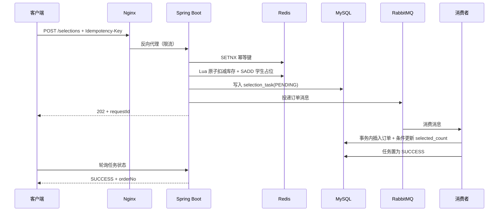

# 拾课 · 校园课程抢选系统

一个可以直接运行的校园抢选系统后端与演示台。重点解决选课开放瞬间的**超卖、重复下单、突发流量和异步落单**问题。

- Spring Boot 3.3 / Java 17 / MyBatis-Plus
- MySQL 8.4 + Flyway
- Redis 7 + Lua（库存原子预扣、令牌桶、幂等键）
- RabbitMQ 3.13（异步订单、死信队列、任务补偿）
- Nginx + HTTPS + Docker Compose
- 15 个 REST 接口，自带 Swagger 与网页演示台
- JWT 登录鉴权、参数校验、统一错误码、traceId 日志

> 说明：本项目不包含 JMeter 压测脚本。性能数字请以你本机的实际压测结果为准，README 只描述设计与调优方向。

---

## 1. 快速启动

### 方式 A：Docker Compose（推荐，一条命令）

```bash
cp .env.example .env          # 修改数据库、Redis、RabbitMQ、JWT 密码
bash scripts/gen-certs.sh     # 生成自签名 HTTPS 证书（Windows 用 scripts/gen-certs.ps1）
docker compose up -d --build
```

启动完成后：

| 地址 | 说明 |
| --- | --- |
| https://localhost | 网页演示台（自签名证书需在浏览器确认继续访问） |
| http://localhost:8080/swagger-ui.html | Swagger API 文档 |
| http://localhost:8080/actuator/health | 健康检查 |
| http://localhost:15672 | RabbitMQ 管理台（账号见 `.env`） |
| localhost:3307 | MySQL（避免和本机 3306 冲突，容器内仍是 3306） |

演示账号（`DEMO_DATA_ENABLED=true` 时自动创建）：

| 角色 | 账号 | 密码 |
| --- | --- | --- |
| 学生 | `20260001` | `Student@123` |
| 学生 | `20260002` | `Student@123` |
| 管理员 | `admin` | `Admin@123` |

停止服务：

```bash
docker compose down          # 保留数据卷
docker compose down -v       # 连同 MySQL/Redis/RabbitMQ 数据一起清空
```

### 方式 B：使用你电脑上已有的 MySQL

本机默认配置为 `localhost:3306/campus_selection`，账号 `campus / campus123`。

1. 用有建库权限的 MySQL 账号执行初始化脚本：

```bash
mysql -uroot -p < scripts/init-local-db.sql
```

2. 启动 Redis 和 RabbitMQ。已有服务则跳过；没有 Docker 时需自行安装并保证：
   - Redis：`localhost:6379`，密码默认 `campus123`
   - RabbitMQ：`localhost:5672`，账号 `campus / campus123`

3. 启动应用：

```bash
mvn spring-boot:run
```

如果本机 MySQL 账号/密码不同，用环境变量覆盖，不需要改代码：

```powershell
$env:DB_USERNAME="root"
$env:DB_PASSWORD="你的密码"
$env:REDIS_PASSWORD=""
$env:RABBITMQ_PASSWORD="你的密码"
mvn spring-boot:run
```

> Flyway 会在首次启动时自动建表并插入 12 门演示课程；学生/管理员账号由 `DemoDataInitializer` 创建。

---

## 2. 15 个接口

统一前缀 `/api/v1`，除登录/刷新外都需要 `Authorization: Bearer <accessToken>`。

| # | 方法 | 路径 | 权限 | 说明 |
| --- | --- | --- | --- | --- |
| 1 | POST | `/auth/login` | 公开 | 学号密码登录，返回 access + refresh token |
| 2 | POST | `/auth/refresh` | 公开 | 刷新访问令牌 |
| 3 | GET | `/auth/me` | 登录 | 当前用户信息 |
| 4 | GET | `/courses` | 登录 | 分页课程列表，支持关键词/类别/热度排序 |
| 5 | GET | `/courses/hot` | 登录 | 热门课程 Top N，Redis 缓存 30 秒 |
| 6 | GET | `/courses/{courseId}` | 登录 | 课程详情与实时余量 |
| 7 | GET | `/courses/{courseId}/stock` | 登录 | 单独查询 Redis 实时库存 |
| 8 | POST | `/selections` | 学生 | 抢选课程，异步受理，必须带 `Idempotency-Key` |
| 9 | GET | `/selections/tasks/{requestId}` | 本人/管理员 | 查询异步任务状态 |
| 10 | GET | `/selections/orders` | 本人 | 分页查询我的订单，可按状态筛选 |
| 11 | GET | `/selections/orders/{orderNo}` | 本人 | 订单详情 |
| 12 | DELETE | `/selections/orders/{orderNo}` | 本人 | 取消选课并归还名额 |
| 13 | POST | `/admin/courses` | 管理员 | 新建课程 |
| 14 | PUT | `/admin/courses/{courseId}` | 管理员 | 编辑课程、发布/停用、调整容量 |
| 15 | GET | `/admin/selections/statistics` | 管理员 | 订单、任务、成功率运营统计 |

### 响应格式

```json
{
  "code": 0,
  "message": "成功",
  "data": {},
  "traceId": "b7c1f3d2a9e84d2c8f1a0e6b7c3d5a91",
  "timestamp": 1790000000000
}
```

- `code = 0` 表示成功，非 0 为业务错误；HTTP 状态码同时具有语义（400/401/403/404/409/429/503）。
- 每个响应都带 `traceId`，同时在响应头 `X-Request-Id` 与日志中输出，便于串联排查。

### 抢选调用示例

```bash
# 1. 登录
curl -s http://localhost:8080/api/v1/auth/login \
  -H "Content-Type: application/json" \
  -d '{"studentNo":"20260001","password":"Student@123"}'

# 2. 抢选（Idempotency-Key 建议由客户端生成 UUID，重试时必须复用同一个 key）
curl -i -s http://localhost:8080/api/v1/selections \
  -H "Authorization: Bearer $TOKEN" \
  -H "Content-Type: application/json" \
  -H "Idempotency-Key: 6f1d8c2a9b7e4d3f8a1c5e9b2d7f4a60" \
  -d '{"courseId":1}'

# 3. 轮询异步任务
curl -s http://localhost:8080/api/v1/selections/tasks/$REQUEST_ID \
  -H "Authorization: Bearer $TOKEN"

# 4. 我的订单
curl -s "http://localhost:8080/api/v1/selections/orders?page=1&size=10" \
  -H "Authorization: Bearer $TOKEN"

# 5. 取消选课
curl -X DELETE -s http://localhost:8080/api/v1/selections/orders/$ORDER_NO \
  -H "Authorization: Bearer $TOKEN"
```

---

## 3. 核心设计

### 3.1 抢选主链路



关键点：

1. **Lua 原子扣减**：`SISMEMBER -> GET -> DECR -> SADD` 在 Redis 单线程中一次完成，避免“先查后减”的竞态。
2. **数据库第二道闸门**：消费端仍执行 `selected_count < capacity` 条件更新，Redis 异常或数据漂移时也不会超卖。
3. **唯一索引兜底**：`selection_order(student_id, course_id, active)` 保证一个学生同一门课最多一个有效订单；`selection_task(student_id, idempotency_key)` 保证重复提交只产生一个任务。
4. **异步落单**：Redis 预扣成功后立即返回 202，由 RabbitMQ 削峰，消费者并发 4-16、prefetch 20。
5. **失败补偿**：消息投递失败、消费异常、任务超时都会释放 Redis 占位；释放脚本按 `SREM` 结果幂等归还，避免重复加库存。

### 3.2 防重复与幂等

| 层级 | 机制 | 作用 |
| --- | --- | --- |
| 客户端 | `Idempotency-Key`（8-64 位） | 同一次抢选重试复用同一个 key |
| Redis | `SETNX ccs:idem:{studentId}:{key}`，TTL 24h | 请求级快速短路 |
| MySQL | `uk_task_student_idem(student_id, idempotency_key)` | 并发下最终唯一 |
| 业务 | 查询有效订单 + `uk_order_student_course_active` | 防止同一课程重复选中 |

取消订单时 `active` 从 1 变为 `NULL`。MySQL 唯一索引允许多个 `NULL`，所以学生可以取消、重选、再取消，始终最多只有一个有效订单，同时保留全部历史订单。

### 3.3 令牌桶限流

`lua/token_bucket.lua` 以“容量 + 每秒补充速率”维护每个学生的令牌数，默认：

- 容量 10（允许短时突发 10 次）
- 每秒补充 5 个令牌
- Redis key TTL 120 秒

被限流返回 HTTP 429 / 业务码 `42901`。Nginx 层再对 `/api/v1/selections` 做 IP 级限流（80 r/s，burst 100）。

### 3.4 日志与可追溯

- `TraceIdFilter` 接受或生成 `X-Request-Id`，写入 MDC，响应头和所有日志行都带 `traceId`。
- `RequestLoggingFilter` 记录 method/path/status/耗时/IP，慢请求可直接从日志筛出。
- RabbitMQ 消费、任务失败、库存释放都带 `requestId`，可以从一次抢选追踪到最终订单。

### 3.5 数据库索引与连接池

`V1__init_schema.sql` 中的关键索引：

| 索引 | 支撑的查询 |
| --- | --- |
| `idx_course_status_start(status, select_start_time, select_end_time)` | 课程列表按状态/时间过滤 |
| `idx_course_status_hot(status, selected_count)` | 热门课程排序 |
| `idx_order_student_status_created(student_id, status, created_at)` | 我的订单分页 |
| `uk_order_student_course_active(student_id, course_id, active)` | 防重复选课 |
| `idx_task_status_updated(status, updated_at)` | 超时任务扫描/补偿 |

默认 Hikari `maximum-pool-size=50`、Tomcat `max-threads=400`，可通过环境变量 `DB_POOL_MAX` 等调整。真实压测时建议重点观察连接池等待、慢 SQL 与消费者堆积。

---

## 4. 配置项

| 环境变量 | 默认值 | 说明 |
| --- | --- | --- |
| `DB_URL` | `jdbc:mysql://localhost:3306/campus_selection?...` | MySQL 连接串 |
| `DB_USERNAME` / `DB_PASSWORD` | `campus` / `campus123` | 数据库账号 |
| `DB_POOL_MAX` / `DB_POOL_MIN` | `50` / `10` | Hikari 连接池 |
| `REDIS_HOST` / `REDIS_PORT` | `localhost` / `6379` | Redis |
| `REDIS_PASSWORD` | 空 | Redis 密码 |
| `RABBITMQ_HOST` / `RABBITMQ_PORT` | `localhost` / `5672` | RabbitMQ |
| `RABBITMQ_USER` / `RABBITMQ_PASSWORD` | `campus` / `campus123` | RabbitMQ 账号 |
| `JWT_SECRET` | 内置演示值 | **生产必须替换，至少 32 字节** |
| `JWT_ACCESS_TTL` / `JWT_REFRESH_TTL` | `7200` / `604800` 秒 | Token 有效期 |
| `SELECTION_RATE_CAPACITY` | `10` | 令牌桶容量 |
| `SELECTION_RATE_REFILL` | `5` | 每秒补充令牌数 |
| `IDEMPOTENCY_TTL` | `86400` 秒 | 幂等键有效期 |
| `DEMO_DATA_ENABLED` | `true` | 是否创建演示账号 |
| `CORS_ALLOWED_ORIGINS` | `*` | 允许的前端来源 |

---

## 5. 工程结构

```text
campus-course-selection/
├── src/main/java/com/campus/selection/
│   ├── auth/                 # 登录、JWT、演示账号
│   ├── course/               # 课程查询、库存、管理端课程
│   ├── selection/            # 抢选、Lua 库存、限流、MQ、订单、补偿
│   ├── common/               # 统一响应、异常、安全、日志、配置
│   └── domain/               # 状态枚举
├── src/main/resources/
│   ├── db/migration/         # Flyway 建表与种子课程
│   ├── lua/                  # 库存扣减/释放、令牌桶脚本
│   ├── static/               # 零构建网页演示台
│   └── application.yml
├── src/test/java/            # JWT、鉴权、幂等、订单号单测
├── deploy/nginx/             # HTTPS 反向代理
├── deploy/certs/             # 本地自签名证书（不提交私钥）
├── scripts/                  # 证书生成、本机数据库初始化
├── Dockerfile
├── docker-compose.yml
└── pom.xml
```

---

## 6. 测试

```bash
mvn test
```

当前单测覆盖：

- JWT access/refresh token 类型隔离与 claims 还原
- 未知账号/禁用账号统一返回凭证错误
- 订单号格式与 10000 次生成唯一性
- 抢选缺少合法幂等键时在访问 Redis 前快速失败
- Lua 返回售罄时清理幂等键

---

## 7. 生产前检查清单

- [ ] 替换 `JWT_SECRET`、MySQL/Redis/RabbitMQ 密码
- [ ] `DEMO_DATA_ENABLED=false`
- [ ] 使用 CA 签发的 HTTPS 证书替换 `deploy/certs`
- [ ] 为 Nginx 配置真实域名与访问日志轮转
- [ ] 根据机器规格调整 Tomcat 线程、Hikari 连接池、消费者并发
- [ ] 监控 RabbitMQ 队列积压、死信队列、Redis 内存、MySQL 慢查询
- [ ] 多实例部署时确认 Redis/RabbitMQ/MySQL 均为共享外部服务

### 已知边界

- 当前按单 Redis 主节点设计；Redis 故障时抢选接口会快速失败（fail-closed），课程浏览仍可回源数据库。
- 发布确认回调只记录日志；PENDING 任务由 `SelectionTaskReconciler` 每 60 秒重投/失败补偿。
- 管理员在选课进行中调整容量会重建该课程库存，建议在低峰期操作。

更多实现细节见 [docs/ARCHITECTURE.md](docs/ARCHITECTURE.md) 与 [docs/API.md](docs/API.md)。
