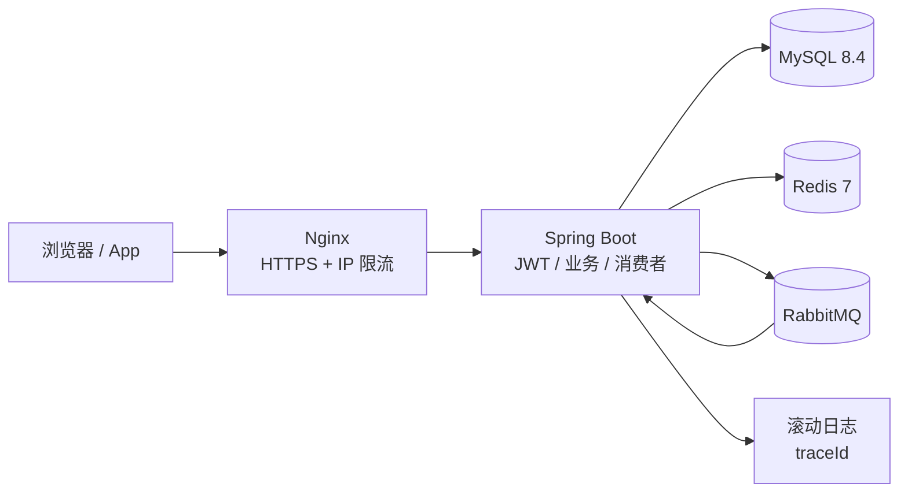
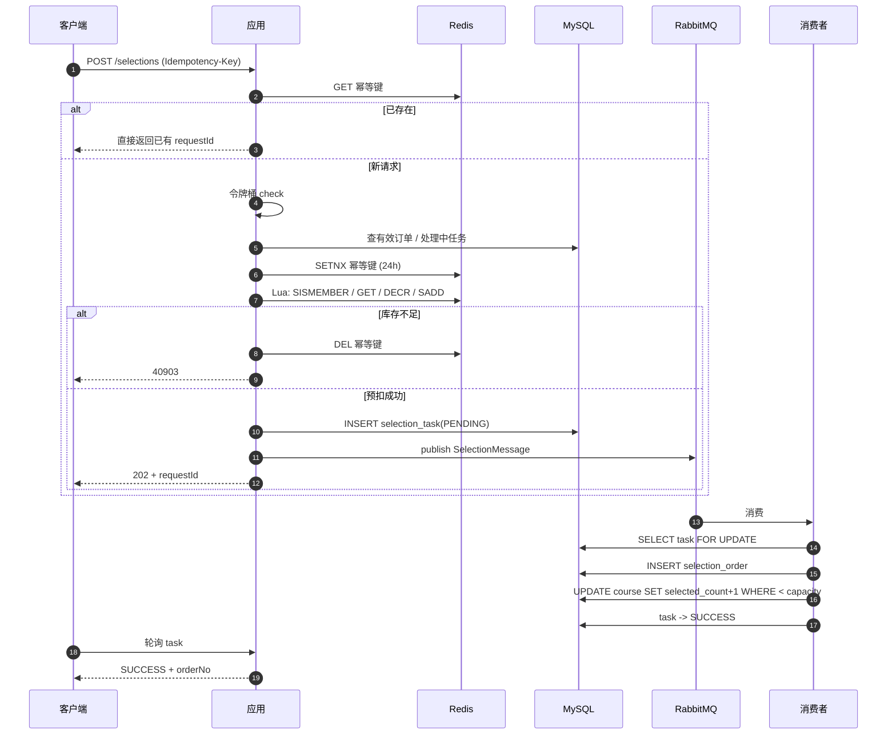

# 架构与一致性设计

## 1. 组件



- **Nginx**：TLS 终止、反向代理、安全响应头、对抢选路径做 IP 级限流。
- **Spring Boot**：无状态 JWT 鉴权、课程查询、抢选编排、订单消费者、定时补偿。
- **MySQL**：学生、课程、订单、抢选任务的最终事实来源。
- **Redis**：库存预扣、已占位学生集合、幂等键、令牌桶、热门课程缓存。
- **RabbitMQ**：抢选任务削峰，订单队列 + 死信队列。

## 2. 抢选时序



## 3. 防超卖的三层保证

### 第一层：Redis Lua 原子预扣

`stock_deduct.lua` 在一次脚本执行内完成：

```text
SISMEMBER selected:{courseId} studentId   -- 同课程重复占位拦截
GET stock:{courseId}                      -- 读取余量
DECR stock:{courseId}                     -- 原子扣减
SADD selected:{courseId} studentId         -- 记录占位
```

Redis 单线程执行 Lua，不存在并发脚本交错，因此不会出现“两个请求同时看到 1 个名额”。

### 第二层：数据库条件更新

消费者在事务内执行：

```sql
UPDATE course
   SET selected_count = selected_count + 1
 WHERE id = ?
   AND status = 'PUBLISHED'
   AND selected_count < capacity;
```

受影响行数为 0 即视为售罄，事务回滚并触发补偿。即使 Redis 被清空、数据漂移或脚本被绕过，数据库也不会把 `selected_count` 推到 `capacity` 以上。表上还有 `CHECK (selected_count <= capacity)` 约束。

### 第三层：唯一索引

| 唯一索引 | 防的是什么 |
| --- | --- |
| `uk_order_student_course_active(student_id, course_id, active)` | 同一学生同一课程重复有效订单 |
| `uk_task_student_idem(student_id, idempotency_key)` | 同一幂等键重复建任务 |
| `uk_order_request_id(request_id)` | 同一请求重复落单 |
| `uk_order_no(order_no)` | 订单号冲突 |

`active` 为 1 表示有效订单，取消后置 `NULL`。MySQL 唯一索引允许多个 `NULL`，这样既保证有效订单唯一，又允许反复取消/重选，同时保留历史订单。取消 SQL 不能写成 `active=0`，否则第二次取消会与历史取消记录撞唯一索引。

## 4. 幂等设计

### 请求级

客户端传 `Idempotency-Key`。服务端：

1. `GET ccs:idem:{studentId}:{key}`，命中则按 `requestId` 返回已有任务。
2. 未命中则 `SETNX` 占位，TTL 24 小时。
3. 建任务时写 `selection_task(student_id, idempotency_key)` 唯一索引，数据库兜底。
4. 相同 key 但课程不同，返回 `40907`，防止跨请求复用。

### 消息级

RabbitMQ 至少一次投递，消息可能重复。消费者：

1. `SELECT ... FOR UPDATE` 锁定任务行。
2. 任务已是 `SUCCESS` / `FAILED` 直接返回。
3. 已有有效订单则把任务置为 `SUCCESS`，不再插入订单。
4. 订单唯一索引冲突由消费者捕获，调用 `resolveDuplicate` 转为成功。
5. 只有任务状态真正从 `PENDING/PROCESSING` 变为 `FAILED` 的调用才释放库存，避免重复归还。

## 5. 失败与补偿矩阵

| 失败点 | 已发生的事实 | 处理 |
| --- | --- | --- |
| Lua 扣减失败/售罄 | 无占位 | 删除幂等键，返回 40903 |
| 任务入库失败 | Redis 已扣 | `release` 归还，删幂等键，返回错误 |
| MQ 投递异常 | Redis 已扣、任务已建 | 任务置 FAILED + `release` + 删幂等键，返回 503 |
| 消费者处理异常 | 订单事务回滚 | 任务置 FAILED + `release` |
| 订单唯一索引冲突 | 已有订单 | 任务置 SUCCESS，不重复归还 |
| 消息重复投递 | 任务已终态 | 直接 ack |
| 任务长时间 PENDING | 消息可能丢失 | 定时器重投，消费者幂等 |
| 任务长时间 PROCESSING | 消费者可能崩溃 | 10 分钟后置 FAILED + `release` |
| 取消订单 | DB 已提交 | 事务 afterCommit 用 Lua `SREM` 成功才 `INCR` |
| 应用重启 | Redis 可能丢失 | 启动时按“有效订单 + 处理中任务”重建库存和占位集合 |

## 6. 库存重建

`StockBootstrapRunner` 在启动时对已发布/关闭课程执行：

```text
占用集合 = 有效订单学生 ∪ PENDING/PROCESSING 任务学生
remaining = max(0, capacity - |占用集合|)
```

先写 `stock` 再重建 `selected` 集合，避免把重启前在途的请求误算成可售名额。Redis 完全丢失时，课程查询也会按需回源重建。

## 7. 限流

- 应用层：`token_bucket.lua` 按学生维度限流，容量 10、每秒补充 5、TTL 120 秒。
- Nginx 层：按 IP 对 `/api/v1/selections` 限流 80 r/s，burst 100。
- 两层限流目的不同：Nginx 保护入口，应用层保护单个学生的刷接口行为。

## 8. 数据库与性能

### 索引

- 课程列表：`(status, select_start_time, select_end_time)`、`(category, status)`
- 热门排序：`(status, selected_count)`
- 我的订单：`(student_id, status, created_at)`
- 任务补偿：`(status, updated_at)`
- 防重：订单/任务唯一索引

### 连接池与线程

- Hikari `maximum-pool-size=50`（`DB_POOL_MAX` 可调）
- Tomcat `max-threads=400`、`accept-count=200`、`max-connections=10000`
- RabbitMQ 消费者并发 4-16、prefetch 20

### 压测建议

不提供虚假压测数字。建议用 JMeter/wrk 按以下顺序定位：

1. 固定课程、固定学生集合，先测登录与课程列表，确认基线。
2. 抢选场景使用不同学生、不同 `Idempotency-Key`，观察 202 比例、40903、429。
3. 观察 Hikari `active/idle/pending`、MySQL 慢查询、RabbitMQ ready/unacked、Redis 命中率。
4. 若 QPS 上不去：先看连接池等待与慢 SQL，再看消费者并发、Tomcat 线程、Nginx 限流阈值。
5. 若 P95 高：检查数据库条件更新锁竞争、MQ 积压、Redis 网络 RTT。

## 9. 可观测性

- 所有响应带 `traceId`，Nginx 透传 `X-Request-Id`。
- 访问日志：method/path/status/duration/ip。
- 业务日志：抢选受理、消费、订单创建、任务失败、库存释放均带 `requestId`。
- Actuator：`/actuator/health`、`/actuator/metrics`。
- RabbitMQ 管理台可观察队列积压与死信。

## 10. 取舍与边界

- **强一致 vs 可用性**：Redis 不可用时抢选 fail-closed（503），课程浏览可回源；这是为了避免在无法保证库存时继续接单。
- **单 Redis**：当前未做 Redis Cluster/哨兵；生产可替换为托管 Redis，Lua 与 key 设计不变。
- **发布确认**：启用了 publisher confirm，回调只记录 nack；最终一致性由 PENDING 任务重投与超时补偿兜底。
- **管理员改容量**：选课进行中调整容量会重建该课程库存，建议低峰操作或加分布式锁。
- **取消时间**：当前只允许在课程选课结束前取消；如需“开课后不可退”可调整 `SelectionService.cancel` 的判断。
